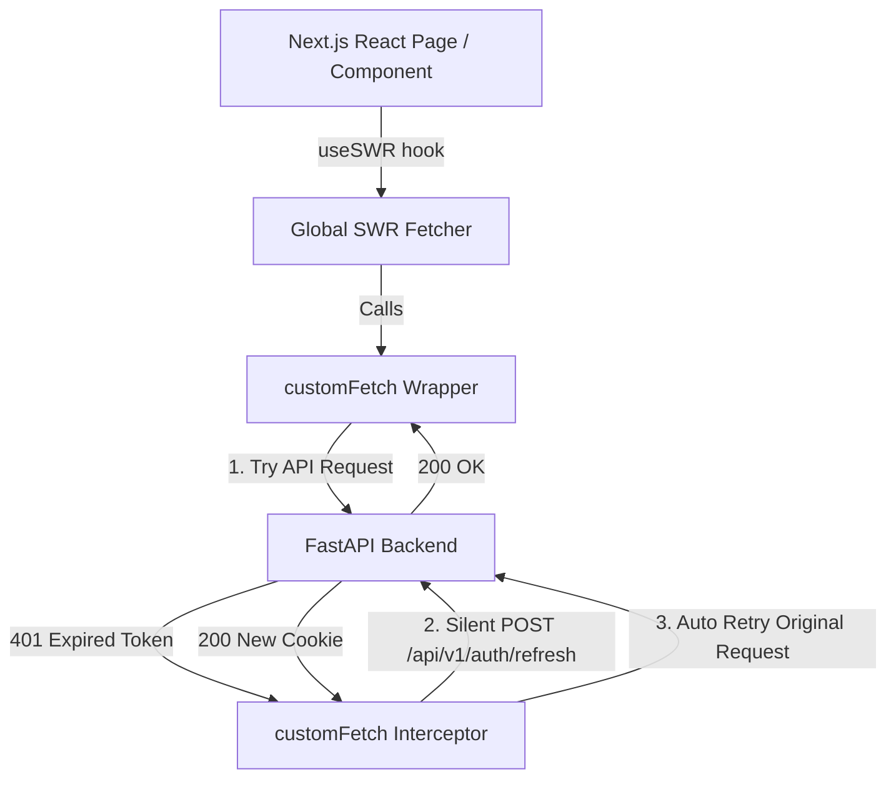

# Frontend SWR & Silent Token Refresh Integration Plan

This plan documents the frontend architecture for data fetching, authentication session management, and silent token refreshing using **SWR** and native `fetch()` for the DeskFlow Next.js frontend (`HRM-frontend`).

---

## 1. Core Architecture Overview



---

## 2. API Client Implementation (`lib/api.ts`)

```typescript
const BASE_URL = process.env.NEXT_PUBLIC_API_URL || 'http://localhost:8000';

/**
 * Custom Fetch Wrapper with automatic 401 silent token refresh retry logic.
 */
export async function customFetch(endpoint: string, options: RequestInit = {}) {
  options.credentials = 'include'; // Send & receive HttpOnly cookies
  options.headers = {
    'Content-Type': 'application/json',
    ...options.headers,
  };

  const fullUrl = `${BASE_URL}${endpoint}`;
  let response = await fetch(fullUrl, options);

  // 1. If 401 Unauthorized (Access Token Expired after 1 hr)
  if (response.status === 401 && !endpoint.includes('/auth/login') && !endpoint.includes('/auth/refresh')) {
    // 2. Silently request new Access Token using Refresh Token cookie
    const refreshRes = await fetch(`${BASE_URL}/api/v1/auth/refresh`, {
      method: 'POST',
      credentials: 'include',
    });

    if (refreshRes.ok) {
      // 3. Token refreshed! Automatically RETRY original request
      response = await fetch(fullUrl, options);
    } else {
      // 4. Hard expiry: Refresh token expired (e.g. 30 days) -> redirect to login
      if (typeof window !== 'undefined' && !window.location.pathname.includes('/login')) {
        window.location.href = '/login';
      }
    }
  }

  if (!response.ok) {
    const errorData = await response.json().catch(() => ({}));
    throw new Error(errorData.detail || 'An unexpected error occurred');
  }

  return response.json();
}

// Global SWR Fetcher
export const fetcher = (url: string) => customFetch(url);
```

---

## 3. Global Auth Hook (`hooks/useUser.ts`)

```typescript
import useSWR from 'swr';
import { customFetch, fetcher } from '@/lib/api';

export function useUser() {
  const { data, error, mutate } = useSWR('/api/v1/auth/me', fetcher, {
    shouldRetryOnError: false,
    revalidateOnFocus: true,
  });

  const loading = !data && !error;
  const loggedOut = error && error.message.includes('Authentication required');

  async function login(email: string, password: string) {
    const res = await customFetch('/api/v1/auth/login', {
      method: 'POST',
      body: JSON.stringify({ email, password }),
    });
    await mutate(); // Instantly update global user state
    return res;
  }

  async function logout() {
    await customFetch('/api/v1/auth/logout', { method: 'POST' });
    await mutate(null, false); // Clear SWR user cache
  }

  async function switchOutlet(target_outlet_id: number) {
    const res = await customFetch('/api/v1/auth/switch-outlet', {
      method: 'POST',
      body: JSON.stringify({ target_outlet_id }),
    });
    await mutate(); // Re-fetch /me to update active_outlet_id globally
    return res;
  }

  return {
    user: data,
    loading,
    loggedOut,
    login,
    logout,
    switchOutlet,
    mutate,
  };
}
```

---

## 4. Usage in Components & Next.js Pages

### Protected Layout (`app/(dashboard)/layout.tsx`)
```tsx
'use client';
import { useUser } from '@/hooks/useUser';
import { useRouter } from 'next/navigation';
import { useEffect } from 'react';

export default function DashboardLayout({ children }: { children: React.ReactNode }) {
  const { user, loading, loggedOut } = useUser();
  const router = useRouter();

  useEffect(() => {
    if (loggedOut) {
      router.push('/login');
    }
  }, [loggedOut, router]);

  if (loading) return <div>Loading DeskFlow PMS...</div>;
  if (!user) return null;

  return (
    <div className="flex h-screen">
      <Sidebar user={user} />
      <main className="flex-1 overflow-y-auto">{children}</main>
    </div>
  );
}
```

---

## 5. Next Steps for Implementation

1. **Backend**: Add `POST /api/v1/auth/refresh` endpoint when long-lived refresh tokens are needed.
2. **Frontend**: Copy `lib/api.ts` and `hooks/useUser.ts` into `HRM-frontend`.
3. **Test**: Verify automatic silent refresh when access token expires.
